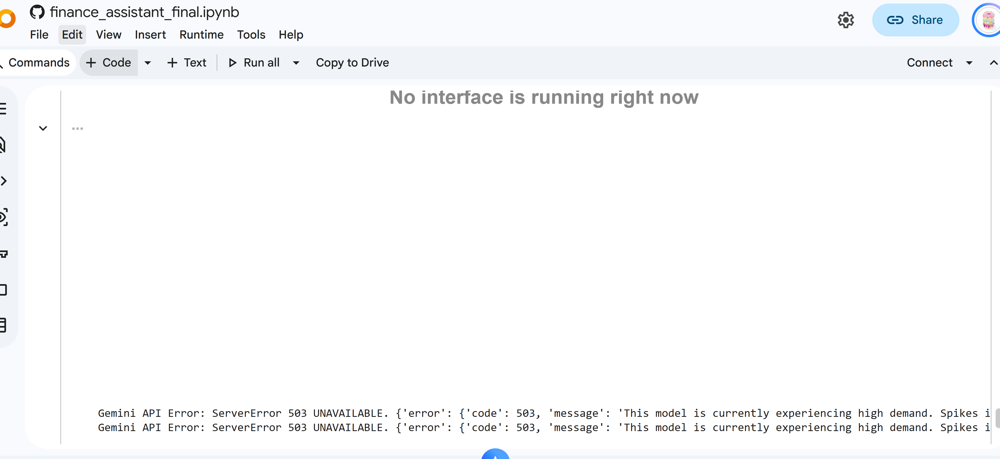

# Developer's Diary

## Week 1 – 12 October 2026

### Objective
Design the Student Budget Assistant.

### Work Completed
- Defined the financial problem.
- Completed the six-step method.
- Developed the initial budget calculator.

### AI Collaboration
Used ChatGPT to understand the assessment requirements
and develop the initial Python functions.

### Reflection
Reviewed the code and tested the budget calculations.

## Week 1 – 16 October 2026 (Progress Update)

### Objective

Integrate Gemini AI into the Student Budget Assistant, develop an interactive Gradio interface, test the application's functionality, and complete the project documentation.

### Work Completed

- Connected the Gemini API using Google Colab Secrets to keep the API key out of the source code.
- Integrated the `calculate_budget()` function with Gemini to provide personalised financial advice based on users' income and expenses.
- Developed a Gradio interface where users can enter their monthly income, expenses, and financial questions.
- Tested normal, over-budget, and invalid-input scenarios.
- Investigated and corrected errors encountered during Gemini integration.
- Completed the README, including the project overview, features, sample input/output, and instructions for running the application.

### AI Collaboration

I used ChatGPT to assist with debugging, understanding Python errors, and improving the reliability of the application. My interactions with ChatGPT were mainly in Vietnamese. The following excerpts have been translated into English.

**1. Debugging the `UnboundLocalError`**

**Error encountered:**

`UnboundLocalError: cannot access local variable 'prompt' where it is not associated with a value`

**AI Response (translated from Vietnamese):**

"This error is not caused by Gemini being overloaded. Python is trying to use the `prompt` variable before it has been assigned a value.

Most likely, the `prompt = f"""..."""` statement is incorrectly indented or placed inside a condition that was not executed."

**Action taken:**

I reviewed the structure and indentation of the code, corrected the placement of the `prompt` variable, and tested the application again.

**2. Investigating the Gemini API error**

**Error encountered:**

`Gemini API Error: ServerError 503 UNAVAILABLE`

The error message indicated that the Gemini model was experiencing high demand.

I used ChatGPT to investigate the issue and understand the difference between a temporary API service error and a Python programming error.

**Action taken:**

I added retry handling for temporary `503` errors so that the application could attempt the request again before returning an error message.

**3. Debugging the Gradio interface**

**My prompt (translated from Vietnamese):**

"Why does Google Colab keep showing 'Executing'?"

**AI Response (summary):**

ChatGPT explained that running Gradio with `debug=True` can keep the Colab cell in an executing state while the interface is active.

**Action taken:**

I kept `debug=True` during testing because it helped display error information in Google Colab.

### Decisions and Modifications

**1. Improving error visibility**

Initially, the exception-handling code displayed only a general error message:

```python
except Exception:
    advice = "Gemini is temporarily unavailable."
```

After reviewing the debugging guidance, I modified it to:

```python
except Exception as error:
    print("Gemini API Error:", type(error).__name__, str(error))
    advice = "Gemini is temporarily unavailable. Check Colab for details."
```

This change allowed me to identify specific errors instead of receiving the same message for every failure.

I also changed:

```python
demo.launch()
```

to:

```python
demo.launch(debug=True)
```

This made debugging easier by displaying error information in Google Colab.

**2. Handling temporary API failures**

I added retry handling for temporary Gemini API errors, particularly `503 UNAVAILABLE`.

I chose this approach because temporary server errors may occur even when the Python code is correct.

**3. Separating calculations from AI-generated advice**

I kept the `calculate_budget()` function responsible for calculating total expenses, remaining balance, and budget status.

Gemini was used to interpret these results and generate financial recommendations.

I preferred this approach because financial calculations can be checked directly using Python tests, while Gemini's advice requires additional review.

### Testing and Validation

I tested the application using several scenarios.

| Test Case | Expected Result | Actual Result |
| --- | --- | --- |
| Normal budget | Correct calculations and positive remaining balance | Passed |
| Over-budget scenario | Negative remaining balance and "Over Budget" status | Passed |
| Negative expense input | Invalid input rejected | Passed |
| Financial question | Gemini provides advice based on budget information | Passed |

**Example 1 – Normal Budget**

Monthly income: AUD 2,000

- Food: AUD 400
- Transport: AUD 300
- Rent: AUD 700
- Shopping: AUD 200
- Other: AUD 100

Total expenses: AUD 1,700

Remaining balance: AUD 300

Budget status: Within Budget

**Example 2 – Over Budget**

When rent was increased to AUD 1,500, total expenses increased to AUD 2,500.

Remaining balance: AUD -500

Budget status: Over Budget

I also tested Gemini using the question:

"How can I save $200 more per month?"

Gemini suggested reducing spending in categories such as shopping, food, and transport based on the entered financial information.

### Reflection

This session helped me understand how to integrate a generative AI model into a Python application and connect it to a user-friendly interface.

The debugging process was particularly useful because I encountered two different types of errors. The `503 UNAVAILABLE` error was related to the Gemini service, whereas `UnboundLocalError` was caused by the structure of my Python code.

I learned that displaying detailed error messages is more useful than hiding every error behind a general response. I also improved my understanding of variable assignment, indentation, and exception handling.

Although AI provided explanations and suggested modifications, I reviewed the changes and tested the application myself. I did not rely on Gemini to perform the financial calculations, as these could be implemented and validated more reliably through my own Python function.

Overall, this experience improved my confidence in debugging, testing, and evaluating AI-generated suggestions.

### Evidence

**Figure 1 – Gemini API Error (503 UNAVAILABLE)**



**Figure 2 – AI Debugging Discussion**

ChatGPT explanation of the `UnboundLocalError`, including the possible indentation or variable-assignment issue. 

**AI Response:**

**2. Error: `UnboundLocalError: prompt`**

This error is not caused by Gemini being overloaded. Python is trying to use the `prompt` variable before it has been assigned a value.

Most likely, the `prompt = f"""..."""` statement is incorrectly indented or placed inside a condition that was not executed.

**Note:** `prompt = f"""` and `try:` must be indented at the same level, inside the `budget_assistant()` function.

After making the changes, run the code cell again and try clicking Submit.


